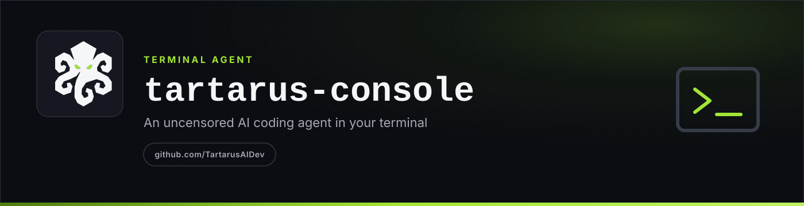

<p align="center">
  <a href="https://tartarusai.dev/?utm_source=github&utm_medium=readme&utm_campaign=tartarus-console&utm_content=banner">
    
  </a>
</p>

# tartarus-console

**The `tartarus` CLI: an uncensored AI coding agent in your terminal.**

[](https://pypi.org/project/tartarus-console/)
[](https://pypi.org/project/tartarus-console/)
[](LICENSE)

Tartarus runs in your terminal, reads and edits your files, runs commands, and
ships code other assistants refuse. It talks to the hosted Tartarus Coder model
over an OpenAI-compatible API, so there's nothing to run locally and no GPU
required.

```bash
pip install tartarus-console
tartarus login
tartarus "add a --json flag to this CLI and update the help text"
```

## Why

| | |
|---|---|
| **Ships code, not refusals** | security tooling, scrapers, systems code: it writes them |
| **Agentic** | reads/edits files, runs commands, iterates in your repo |
| **Hosted** | no 48 GB GPU, nothing to download |
| **OpenAI-compatible** | the same backend powers any OpenAI SDK |
| **Crypto-only** | no card, no KYC |

## Requirements

- **Python 3.11+**
- **macOS, Linux, or Windows** (Windows via PowerShell or WSL)
- A network connection and a dashboard token (below). No local GPU.

## Install

```bash
pip install tartarus-console
```

Upgrade later with:

```bash
pip install -U tartarus-console
```

## Log in

Create an account at
**[dash.tartarusai.dev](https://dash.tartarusai.dev/?utm_source=github&utm_medium=readme&utm_campaign=tartarus-console&utm_content=login)**,
open **Account → CLI access**, generate a token, then:

```bash
tartarus login
```

The CLI stores your token in `~/.tartarus/cli-token.json` — that file is the
source of truth, so to rotate a token, regenerate it in the dashboard and
`tartarus login` again.

## Use

```bash
# one-shot
tartarus "write a concurrent TCP port scanner in Go with a -timeout flag"

# interactive session in the current repo
tartarus

# point at a specific directory
tartarus --cwd ./service "write integration tests for the payments module"
```

Common flags:

| Flag | Does |
|---|---|
| `--cwd <dir>` | run the agent against another directory |
| `--help` | full list of commands and flags |
| `--version` | print the installed version |

Run `tartarus --help` for the complete, current list.

## How the agent works

Every request passes through the Tartarus backend, which enforces your plan and
quota and forwards to the inference cluster. You never hold raw model
credentials; your dashboard token is the only thing you manage.

In a session, the agent can **read and edit files** and **run commands** in the
working directory to complete the task, then uses the results to decide what to
do next.

## Running it safely

The agent acts in your working directory **as you** — it can read, write, and
execute. Treat it like a capable pair-programmer with shell access:

- Run it inside a **git repo** (or a copy) so every change is a reviewable diff.
- Prefer a **project directory**, not your home folder or a system path.
- **Review** what it changed before you commit or ship it.
- Keep secrets out of the working tree; the agent can read files there.

## Troubleshooting

| Symptom | Fix |
|---|---|
| `401 Unauthorized` | Token is stale or was revoked. Regenerate it in the dashboard and run `tartarus login` again. |
| `command not found: tartarus` | The install dir isn't on `PATH`. Use `python -m tartarus_console …`, or add your Python scripts dir to `PATH`. |
| Long task times out | Large tasks can hit the request ceiling. Break the prompt into smaller steps. |
| Wrong Python | Needs **3.11+**. Check `python --version`; install into a 3.11+ environment. |

## Known limitations

- **Hosted-only** — it needs network access to `api.tartarusai.dev`; there's no
  offline mode.
- **Billing is crypto-only** — top up in the dashboard.
- The published source dist is readable Python (not obfuscated).

## Build on the API instead

Prefer to call it from your own code?

- [tartarus-sdk](https://github.com/TartarusAIDev/tartarus-sdk) — typed TypeScript client
- [tartarus-mcp](https://github.com/TartarusAIDev/tartarus-mcp) — MCP tool for Claude Desktop / Cursor
- [tartarus-cookbook](https://github.com/TartarusAIDev/tartarus-cookbook) — Python / Node / curl examples

## Links

- Website — [tartarusai.dev](https://tartarusai.dev/?utm_source=github&utm_medium=readme&utm_campaign=tartarus-console&utm_content=links)
- Dashboard — [dash.tartarusai.dev](https://dash.tartarusai.dev/?utm_source=github&utm_medium=readme&utm_campaign=tartarus-console&utm_content=links)

## License

MIT. See [LICENSE](LICENSE).
